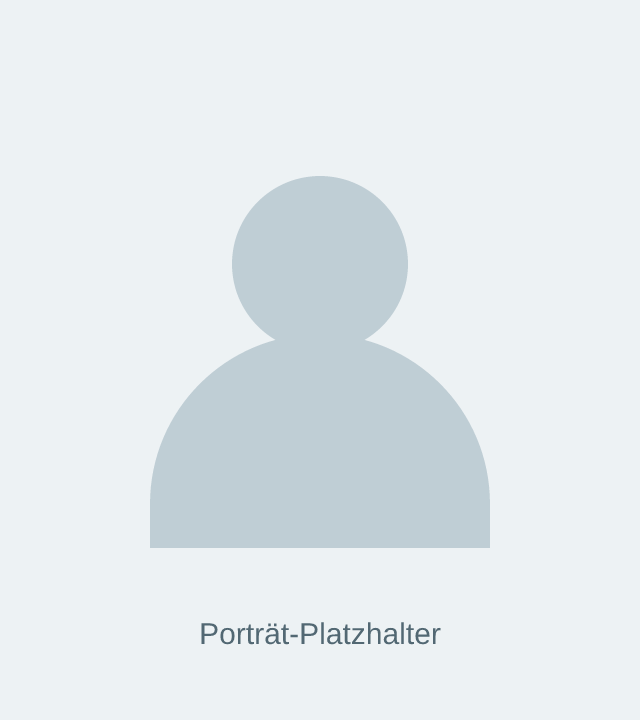

# Website-Pilot Rinalds – Inhaltspflege und Übergabe

Dieses Projekt ist ein statischer Website-Pilot zur Demonstration von Gestaltung, Struktur und Funktionen. Platzhaltertexte und -bilder gehören zum Pilotumfang. Produktiver Go-live, Hosting und laufende Wartung sind nicht Bestandteil des vereinbarten Projekts.

Diese Anleitung dient der späteren Orientierung: Sie zeigt Rinalds und einem nachfolgenden Entwickler, wo Texte und Bilder liegen und wie kleinere Inhaltsänderungen vorgenommen werden können. Die Übergabe erfolgt als ZIP-Archiv per E-Mail.

## 1. Wo liegt die Website und wie ist sie aufgebaut?

Der Quellcode wird im GitHub-Repository [website-rinalds](https://github.com/lekrau/website-rinalds) entwickelt. Rinalds erhält den vereinbarten Übergabestand als ZIP mit Projektdateien, Bildern, Lizenzhinweisen und dieser README. Für die Arbeit mit dem entpackten Projekt ist kein GitHub-Zugriff erforderlich.

Die Website besteht aus statischen Dateien:

| Technologie | Aufgabe | Bei der Inhaltspflege relevant? |
| --- | --- | --- |
| HTML (`.html`) | Texte, Überschriften, Bilder und Links sowie die Struktur der Seiten | Hier werden Inhalte geändert. |
| CSS (`.css`) | Farben, Abstände, Schriftgrößen und Anordnung auf großen und kleinen Bildschirmen | Bei reinen Text- oder Bildwechseln meist unverändert. |
| JavaScript (`script.js`) | Interaktionen wie mobiles Menü, FAQ-Wechsel, Kopieren von Kontaktdaten und Laden des Terminkalenders | Bei reiner Inhaltspflege normalerweise unverändert. |

HTML ist eine Auszeichnungssprache, CSS eine Stylesheet-Sprache und JavaScript die verwendete Programmiersprache. Es gibt derzeit kein Redaktionssystem (CMS), keinen administrativen Bearbeitungsbereich und kein eigenes Backend mit Datenbank. Inhalte werden direkt in den HTML-Dateien gepflegt.

## 2. Welche Datei enthält welchen Inhalt?

| Gewünschte Änderung | Datei und Suchbegriff im Code-Editor |
| --- | --- |
| Hauptüberschrift und großes Bild der Landingpage | [index.html](index.html), nach `class="hero"` suchen |
| Die drei Schritte auf der Landingpage | [index.html](index.html), nach `id="process"` suchen |
| Fragen und kurze Antworten auf der Landingpage | [index.html](index.html), nach `id="FAQ"` suchen |
| Kontaktbereich und eingebetteter Terminkalender | [index.html](index.html), nach `id="contact"` suchen |
| Einleitung der Blogübersicht | [blog.html](blog.html), nach `class="overview-intro"` suchen |
| Titel, Vorschaubilder und Kurztexte der Blogbeiträge | [blog.html](blog.html), nach `class="article-preview"` suchen |
| Artikel „Wie viel Geld bekomme ich?“ | [wie-viel-geld-bekomme-ich.html](wie-viel-geld-bekomme-ich.html), nach `class="article-body"` suchen |
| Artikel „Ist das legal?“ und „Wer sind wir?“ | [ist-das-legal.html](ist-das-legal.html) und [wer-sind-wir.html](wer-sind-wir.html); derzeit einfache TBD-Platzhalterseiten |
| Porträt, Name und Kontaktdaten in den Seitenleisten | [blog.html](blog.html) und [wie-viel-geld-bekomme-ich.html](wie-viel-geld-bekomme-ich.html), nach `class="overview-sidebar"` suchen |
| Impressum und Datenschutz | [impressum.html](impressum.html) und [datenschutz.html](datenschutz.html); derzeit Platzhalter |

Die Landingpage ist die Startseite `index.html`. Die Blogübersicht und die einzelnen Artikel sind eigenständige Seiten. Ihre Inhalte werden nicht automatisch miteinander abgeglichen.

## 3. Kleine Inhaltsänderungen durchführen

### Vorbereitung und Vorschau

1. Das per E-Mail erhaltene ZIP entpacken und als ursprünglichen Übergabestand aufbewahren. Vor Änderungen eine Arbeitskopie des entpackten Projektordners anlegen. Alternativ kann ein Entwickler die Änderungen mit Git verwalten.
2. Den gesamten Ordner in einem Code-Editor öffnen. Nicht mit einem Textverarbeitungsprogramm wie Word bearbeiten.
3. `index.html` im Browser öffnen. Für eine erste Inhaltsvorschau reicht ein Doppelklick. Nach dem Speichern einer Änderung die Browserseite neu laden.
4. Nur die gewünschte Stelle bearbeiten und die Änderung anschließend prüfen. Das Veröffentlichen ist ein separater Schritt; lokal gespeicherte Änderungen sind dadurch noch nicht online.

Der Terminkalender benötigt eine Internetverbindung; alle eingebundenen Bilder liegen lokal im Projekt. Für die Funktionsprüfung kann ein Entwickler die unten beschriebene lokale Vorschau verwenden; einzelne Browserfunktionen können sich beim direkten Öffnen einer Datei anders verhalten.

### Texte auf der Landingpage ersetzen

In `index.html` nach dem sichtbaren Text oder dem Suchbegriff aus der Tabelle suchen. Beispielsweise steht unter einem der drei Schritte:

```html
<p>Lorem ipsum dolor sit amet consectetur adipisicing elit.</p>
```

Für einen neuen Absatztext nur den Inhalt zwischen `<p>` und `</p>` ersetzen:

```html
<p>Hier steht der neue Beschreibungstext für diesen Schritt.</p>
```

Die HTML-Markierungen und ihre Attribute bleiben bei einem reinen Textwechsel erhalten. Das gilt besonders für `class`, `id`, `aria-controls` und `aria-labelledby`: Sie verbinden Inhalte mit Gestaltung, Navigation und Bedienfunktionen. Ein `&` im normalen Text als `&amp;` schreiben, zum Beispiel `Fragen &amp; Antworten`.

Bei den Startseiten-FAQ stehen die Frage im jeweiligen `<button>` und die Antwort im zugehörigen Bereich mit `role="tabpanel"`. Bei einer Umbenennung auch die Überschrift im Antwortbereich prüfen. Die Antwortbereiche gehören über `aria-controls` und `id` zu ihren Tabs; diese Kennungen für reine Textänderungen beibehalten.

### Blogbeiträge bearbeiten

Für den vorhandenen Artikel „Wie viel Geld bekomme ich?“ gibt es mehrere getrennte Textstellen:

- **Artikel selbst:** In `wie-viel-geld-bekomme-ich.html` stehen der Titel bei `id="artikel-titel"`, die Einleitung bei `class="lead"` und die Abschnitte bei `class="article-body"`.
- **Vorschau in der Blogübersicht:** Titel und Kurzbeschreibung in `blog.html` separat anpassen.
- **Kurzantwort auf der Landingpage:** Falls dieselbe Aussage betroffen ist, den zugehörigen FAQ-Bereich in `index.html` ebenfalls anpassen.

Bei einer Titeländerung außerdem den Seitentitel zwischen `<title>` und `</title>` und die sichtbare Bezeichnung in der Brotkrümelnavigation prüfen. Das Inhaltsverzeichnis des Artikels ist manuell geschrieben. Bei geänderten Abschnittsüberschriften seine Beschriftungen mitpflegen; bei neuen oder entfernten Abschnitten auch die Verweise anpassen.

Für einen zusätzlichen Artikel kann ein Entwickler die bestehende Artikelseite als Vorlage verwenden, eine neue HTML-Datei anlegen und die Vorschau in `blog.html` ergänzen. Die einfachen TBD-Seiten enthalten noch kein vollständiges Artikellayout.

### Bilder ersetzen, ohne die Position zu ändern

Bilder werden über `` eingebunden. Beispielsweise steht das Porträt auf den Blogseiten so im Code:

```html

```

Für einen Bildwechsel `src` durch die Adresse des neuen Bildes ersetzen und `alt` als passende kurze Bildbeschreibung aktualisieren. Leere Beschreibungen (`alt=""`) bei rein dekorativen Bildern können leer bleiben. Klasse und umgebende HTML-Struktur erhalten die Position im Layout.

Alle eingebundenen Bilder liegen im Projektordner `assets/images/`: Logo, großes Bild der Landingpage, Kontakticons, Artikel- und Porträtplatzhalter sowie das Symbol für die drei Schritte auf der Landingpage.

Neue Bilder ebenfalls in `assets/images/` ablegen, etwa als `assets/images/portraet.jpg`; dann diesen relativen Pfad als `src` verwenden und den Bildordner mit veröffentlichen. Ein lokaler Pfad wie `/Users/...` funktioniert auf der veröffentlichten Website nicht. Bei externen Bildadressen muss der `src`-Wert direkt auf eine Bilddatei zeigen, nicht auf eine Freigabe- oder Vorschauseite.

Ein ähnliches Seitenverhältnis hilft, den vorgesehenen Bildausschnitt zu erhalten. Bei abweichenden Bildproportionen kann eine Anpassung der Größenangaben oder des Zuschnitts nötig werden. Anschließend auf großem und kleinem Bildschirm prüfen. Ein mehrfach verwendetes Bild, beispielsweise das Logo, muss an allen betroffenen Stellen ersetzt werden.

### Bildquellen und Lizenzstand

Stand: 10.11.2026

| Datei | Quelle / Ersteller | Lizenz |
| --- | --- | --- |
| `Logo_klein_colored.png` | KI-generiert | Im Projekt mit ChatGPT erzeugt; keine separate Bildlizenz dokumentiert. |
| `article-placeholder.png` | KI-generiert | Im Projekt mit Codex erzeugt; keine separate Bildlizenz dokumentiert. |
| `portrait-placeholder.png` | KI-generiert | Im Projekt mit Codex erzeugt; keine separate Bildlizenz dokumentiert. |
| `boxicons-XjQ8nxFvHxw-unsplash.png` | Boxicons auf Unsplash: [Originalseite](https://unsplash.com/illustrations/a-graphic-icon-representing-a-landscape-with-mountains-and-sun-XjQ8nxFvHxw) | Kostenlose, auch kommerzielle Nutzung und Bearbeitung sind erlaubt; Namensnennung ist nicht vorgeschrieben. Es gelten die [Unsplash-Lizenzbedingungen](https://unsplash.com/license). |
| `danneiva-whatsapp-873316_1920.png` | Danneiva auf Pixabay: [Bild 873316](https://pixabay.com/vectors/whatsapp-application-call-873316/) | Die Seite nennt den 05.08.2015 als Veröffentlichungsdatum und zeigt einen Content-License-Hinweis. Nach § 4 der [Pixabay-Nutzungsbedingungen](https://pixabay.com/service/terms/) fällt vor dem 09.01.2019 veröffentlichtes Material unter **CC0**. Markenrechte am WhatsApp-Logo werden dadurch nicht eingeräumt. |
| `geralt-euro-3317432_1920.jpg` | Gerd Altmann / geralt auf Pixabay: [Originalseite, Bild 3317432](https://pixabay.com/de/photos/euro-geschenk-geldgeschenk-hand-3317432/). | Auf der Bildseite verlinkte [Pixabay-Inhaltslizenz](https://pixabay.com/de/service/license-summary/): kostenlose Nutzung und Bearbeitung ohne vorgeschriebene Namensnennung, vorbehaltlich der dort genannten Einschränkungen. Maßgeblich sind die verlinkten vollständigen Lizenzbedingungen. |
| `mail.png` | Feather Icons, Cole Bemis: [Originalsymbol mail.svg](https://github.com/feathericons/feather/blob/main/icons/mail.svg). Selbst von SVG nach PNG konvertiert. | MIT-Lizenz; kommerzielle Nutzung und Bearbeitung erlaubt. Copyright- und Lizenzhinweis liegen in [assets/FEATHER-LICENSE.txt](assets/FEATHER-LICENSE.txt) und sind bei der Weitergabe beizubehalten. |

[CC0](https://creativecommons.org/publicdomain/zero/1.0/) erlaubt urheberrechtlich auch kommerzielle Nutzung ohne vorgeschriebene Namensnennung, überträgt aber insbesondere keine Markenrechte. Für das WhatsApp-Symbol sind deshalb zusätzlich die Markenbedingungen zu berücksichtigen. Bei späteren Bildwechseln Quelle, Urheber und Lizenzstand in dieser Tabelle mitpflegen.

### Kontaktdaten und Terminlinks ändern

Kontaktdaten sind an mehreren Stellen direkt eingetragen: im Kontaktbereich und Footer der Landingpage, in den Seitenleisten der Blogseiten sowie gegebenenfalls auf den rechtlichen Seiten. Im Projekt nach dem alten Wert suchen und die Fundstellen einzeln prüfen.

Bei einem Kopierbutton müssen **sichtbarer Text**, **`data-copy-value`** und die anfängliche **`aria-label`-Beschriftung** zusammenpassen. Nur den sichtbaren Text zu ändern reicht nicht: Der Button würde sonst weiterhin den alten Wert kopieren.

- WhatsApp: Auch das Linkziel mit `https://wa.me/...` aktualisieren.
- E-Mail: Auch die Adresse nach `mailto:` im Linkziel aktualisieren.
- Calendly: Die Terminadresse steht in `index.html` sowohl in `data-url` des Widgets als auch im Ersatzlink. Bei einem Wechsel beide Stellen anpassen und die vorhandenen URL-Parameter des Widgets berücksichtigen.

## 4. Änderungen prüfen

Nach Inhaltsänderungen die betroffenen Seiten im Browser kontrollieren:

- Stimmen Texte, Bilder und Links? Sind auch Vorschautexte und wiederholte Angaben aktualisiert?
- Bleibt das Layout bei schmalem und breitem Browserfenster lesbar, insbesondere bei längeren Texten und neuen Bildern?
- Funktionieren mobiles Menü, FAQ-Wechsel, Inhaltsverzeichnis und Kopierbuttons weiterhin? Bei geänderten Kontaktdaten den tatsächlich kopierten Wert prüfen.
- Stimmen Terminlink und Kalenderziel? Falls der eingebettete Kalender nicht lädt, lässt sich der Ersatzlink öffnen?

Den geprüften Stand als neue Arbeitsversion sichern, beispielsweise mit Git. Eine spätere Veröffentlichung erfordert eine gesonderte Einrichtung von Hosting und Veröffentlichungsweg; diese gehört nicht zur Pilotübergabe.

## 5. Technische Orientierung für einen nachfolgenden Entwickler

Das Projekt verwendet HTML, CSS und JavaScript ohne Framework, Paketinstallation oder Build-Schritt. Es kann von einem Webserver als statische Website ausgeliefert werden. Seitenübergreifend wiederholte Bereiche wie Header und Kontaktdaten sind direkt in den jeweiligen HTML-Dateien enthalten; es gibt derzeit keine gemeinsame Template-Datei.

### Gestaltung

| Datei | Zuständigkeit |
| --- | --- |
| [reset.css](reset.css) | Gemeinsame Browser-Grundformatierung |
| [styles.css](styles.css) | Zentrale Gestaltungsvariablen, gemeinsame Komponenten und Landingpage |
| [knowledge.css](knowledge.css) | Gemeinsame Gestaltung der Blog- und rechtlichen Seiten |
| [blog.css](blog.css) | Blogübersicht |
| [article.css](article.css) | Artikellayout |
| [legal.css](legal.css) | Rechtliche Seiten |
| [tbd.css](tbd.css) | Einfache Artikel-Platzhalterseiten |

[tbd.html](tbd.html) ist eine zusätzliche generische Platzhalterseite mit eigenem Inline-CSS.

### JavaScript

[script.js](script.js) wird auf den ausgebauten Seiten mit `defer` geladen. Die fünf Initialisierungsaufrufe stehen am Dateianfang; die Hilfsfunktionen liegen innerhalb des jeweiligen Bereichs:

| Funktion | Aufgabe |
| --- | --- |
| `setupCalendly()` | Kalender laden und bei Ladeproblemen den Ersatzlink anzeigen |
| `setupSectionNavigation()` | Aktiven Abschnitt in der Kopfzeilennavigation markieren und die gemessene Headerhöhe bereitstellen |
| `setupMobileMenu()` | Mobiles Menü einschließlich Escape-Taste und Zurücksetzen beim Größenwechsel |
| `setupFaqTabs()` | Startseiten-FAQ einschließlich Tastaturbedienung und Direktlinks |
| `setupClipboardButtons()` | Kontaktdaten kopieren und Rückmeldung anzeigen |

Der Menü-Breakpoint von 700 Pixeln steht sowohl im CSS als auch in `setupMobileMenu()` und muss bei einer Änderung abgestimmt werden. Calendly wird als externes Script von `assets.calendly.com` nachgeladen. Der Videobereich im vorhandenen Artikel ist derzeit eine verlinkte Vorschau zur YouTube-Startseite, kein eingebetteter Videoplayer.

### Lokale Vorschau und vorhandene Prüfungen

Optional kann im Projektordner mit installiertem Python 3 ein lokaler Webserver gestartet werden:

```sh
python3 -m http.server 8000 --bind 127.0.0.1
```

Die Vorschau ist anschließend unter `http://127.0.0.1:8000/` erreichbar. Beenden mit `Strg+C` im Terminal.

Für die vorhandenen automatisierten Prüfungen wird Node.js mit Unterstützung für `node:test` benötigt. Eine Paketinstallation ist nicht erforderlich:

```sh
node --check script.js
node --test tests/navigation.test.cjs
```

Die Tests prüfen die aktive Abschnittsnavigation in einer simulierten Browserumgebung. Sie ersetzen keine Browserprüfung von Layout, Menü, FAQ, Kopierfunktion und Calendly.

## 6. Übergabestand und spätere Weiterarbeit

Die Übergabe-E-Mail benennt das Übergabedatum und die Commit-ID des im ZIP enthaltenen Repository-Stands. Das Archiv enthält die Projektdateien einschließlich `assets/` und Lizenzhinweisen; die Git-Historie, private Projektunterlagen und persönliche Zugangsdaten gehören nicht zum Archiv.

Der Pilot enthält Platzhaltertexte und -bilder, zwei TBD-Artikelseiten sowie Platzhalter für Impressum und Datenschutz. Finale Inhalte, weitere ausgearbeitete Artikel und eine spätere CMS-Integration sind nicht Bestandteil dieses Übergabestands. Calendly bleibt als externer Dienst eingebunden; die verwendete Terminadresse steht in `index.html`.

Für eine spätere Beauftragung genügt als technischer Einstieg: „Die Website ist eine statische HTML-/CSS-/JavaScript-Website ohne CMS und Build-Schritt. Texte und Bilder werden direkt in den HTML-Dateien gepflegt. Der Quellcode und die Pflegehinweise liegen im übergebenen ZIP.“ Dieses Archiv bildet die Grundlage für einen nachfolgenden Entwickler; Hosting und Veröffentlichung sind bei Bedarf separat zu organisieren.
